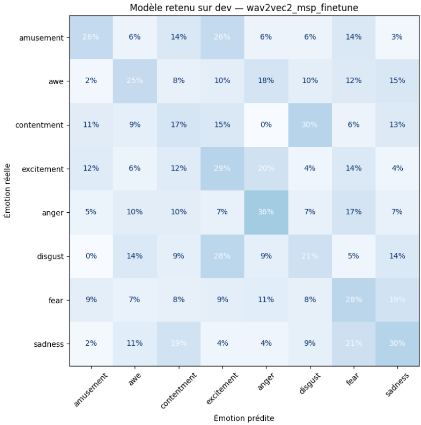

# Reconnaissance des émotions à partir de l'audio

Cette branche prédit l'émotion d'un extrait à partir de sa bande sonore. Nous utilisons le signal audio, sans fournir de transcription ni de description textuelle au modèle. L'audio comprend les voix, la musique et les bruitages.

Le code, les expériences et les résultats sont disponibles dans [Modele_Audio.ipynb](Modele_Audio.ipynb). Les modèles utilisent la [partition commune](../Partition/).

## Exploration des caractéristiques audio

Nous avons commencé avec les 88 caractéristiques acoustiques eGeMAPSv02, extraites avec openSMILE. Une courte analyse sur l'apprentissage porte sur le niveau sonore, la hauteur du son, les variations spectrales et les segments voisés.

L'idée était de comprendre ces mesures avant d'entraîner un classifieur. Leurs distributions se recouvrent largement entre les émotions. De plus, les extraits sans hauteur détectée ou de faible niveau sonore sont conservés parce qu'ils peuvent contenir une information utile sur l'emotion.

## Méthode retenue

Nous utilisons [wav2vec2 d'audEERING](https://huggingface.co/audeering/wav2vec2-large-robust-12-ft-emotion-msp-dim), déjà adapté à la parole émotionnelle sur MSP-Podcast pour prédire l'activation, la dominance et la valence. Nous reprenons son encodeur et ajoutons un classifieur pour nos huit émotions.

Le traitement suit les étapes suivantes :

1. Convertir l'audio en mono à **16 kHz**, le format attendu par l'encodeur.
2. Utiliser des fenêtres allant jusqu'à **10 secondes** pour traiter les extraits de longueurs différentes.
3. Calculer la moyenne des représentations temporelles de wav2vec2, en excluant le remplissage, puis appliquer une standardisation calculée sur l'apprentissage.
4. Classer cette représentation avec un réseau de deux couches cachées de **128 et 64 neurones**, avec ReLU et dropout, suivi d'une sortie à huit classes.
5. Appliquer softmax pour obtenir huit probabilités. À l'évaluation, nous moyennons les probabilités des fenêtres pour produire une prédiction par extrait.

Nous entraînons d'abord le classifieur avec l'encodeur gelé. Nous ajustons ensuite le classifieur, les deux derniers blocs de l'encodeur et sa normalisation finale. L'idée est d'adapter une partie de la représentation à nos films tout en conservant les premières couches préentraînées.

## Entraînement et choix du modèle

L'entraînement utilise AdamW, une perte pondérée selon les effectifs des émotions, du dropout et une régularisation des poids. La régularisation est faite car nous avons remarqué une grande difference entre l'accuracy du entrainement et du développement, ce qui implique une geenralization ou du sur-apprentissage. 
De plus, le taux d'apprentissage diminuent lorsque le F1 macro sur dev stagne. L'arrêt précoce conserve la meilleure époque selon le F1 macro.

Le F1 macro est choisit comme métrique principale car elle donne le même poids à chaque émotion, ce qui est utile avec des classes déséquilibrées. 

## Résultats et limites

| Ensemble | Accuracy | F1 macro |
|---|---:|---:|
| Développement | 27,60 % | 0,2621 |
| Test | 24,15 % | 0,2198 |

Les résultats restent modestes et plusieurs émotions sont confondues.

Ce résulat est plustot attendut car l'émotion d'une scène peut aussi dépendre d'informations visuelles ou du contexte. Cela constitue une difficulté possible pour une prédiction à partir du son seul.

## Autres expériences

Nous avons aussi testé eGeMAPS avec une régression logistique et un réseau de neurones, YAMNet seul ou associé à eGeMAPS, AST, wav2vec2 gelé, HuBERT, emotion2vec+ et MFCC avec un CNN. Ces modeles sont comparaient sur leur résulat de l'ensemble de développement pour accélérer le travail a cause du GPU limite sur Google Colab. 
La comparaison détaillée figure dans le notebook.

## Prédictions pour la fusion

- [probabilites_audio_dev.csv](probabilites_audio_dev.csv)
- [probabilites_audio_test.csv](probabilites_audio_test.csv)

Chaque ligne contient le `video_id` et huit probabilités, avec une colonne par émotion. La fusion peut ainsi relier les sorties des différentes branches grâce au `video_id`.

Les chemins vers les données et les sauvegardes Google Drive sont à adapter dans le notebook. Les poids entraînés ne sont pas inclus dans ce dossier.
