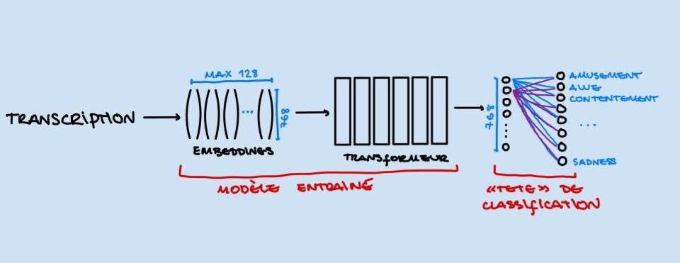

# Modélisation et Classification de Texte (Émotions)

La partie textuelle de notre projet repose sur deux axes principaux : la **transcription** des dialogues et les **descriptions (captions)** des scènes.

Le principe général de cette modélisation consiste à charger un modèle pré-entraîné sur Hugging Face et à lui ajouter une « tête » (*head*) de classification personnalisée que nous entraînons sur nos données. 

Les clips sont classés en **8 émotions** : `amusement`, `awe`, `contentment`, `excitement`, `anger`, `disgust`, `fear`, `sadness`.

---

## 1. Choix de l'architecture d'optimisation

Avant d'entraîner les modèles, nous avons défini les composants fondamentaux pour piloter l'apprentissage :

* **L'optimiseur :** nous avons choisi **AdamW**, car il découple proprement la régularisation (*weight decay*) des gradients adaptatifs. Cela améliore la généralisation et limite l'overfitting.
* **La fonction de perte (*Loss*) :** l'entropie croisée (*Cross-Entropy Loss*), adaptée à la classification multi-classe. Elle pénalise fortement les prédictions erronées mais confiantes du modèle.
* **Les métriques d'évaluation :** **l'exactitude** (*Accuracy*) et le **F1-Macro**. L'accuracy peut avantager les classes majoritaires. Le F1-macro, lui, traite toutes les classes de la même manière : c'est une métrique plus robuste pour vérifier que le modèle ne néglige pas les émotions minoritaires de notre jeu de données.

---

## 2. Préparation des données

### Gestion des transcriptions vides
Une partie des clips ne contient aucune parole (dans la partie transcription: VAD ne détecte pas de voix, ou Whisper renvoie un texte vide). Entraîner le modèle sur ces clips n'a pas de sens : il devrait deviner une émotion à partir d'une chaîne vide, ce qui ajoute du bruit.

* Nous **retirons ces clips** de l'entraînement et du dev (le dev sert à choisir le meilleur epoch). Il reste **1411 clips avec texte sur 2208** dans le train, **281 sur 442** dans le dev et **257 sur 439** dans le test.

### Tokenisation
Les textes sont tronqués à **128 tokens** (`truncation=True`), car très peu de phrases dépassent cette limite. Nous n'ajoutons pas de padding à la tokenisation : un `DataCollatorWithPadding` complète dynamiquement chaque batch, ce qui économise de la mémoire.

---

## 3. Stratégie d'entraînement

* **Architecture détaillée du modèle de classification:** Par exemple, le modèle retenu pour la classification basée sur les transcriptions présente l'architecture suivante :



Comme l'illustre le schéma ci-dessus, le traitement s'effectue en trois grandes étapes :

1. **Tokenisation et Embeddings :** 
   Le texte d'entrée (transcription ou description) est découpé en tokens avec une longueur maximale fixée à 128 (`max_length = 128`). Chaque token est ensuite projeté dans un espace vectoriel de dimension 768.

2. **Passage dans l'Encodeur Transformer :** 
   Ces vecteurs traversent 6 couches de Transformer (dans le cas de `DistilRoBERTa`). À travers ces couches, les tokens partagent et enrichissent leurs informations contextuelles grâce aux mécanismes d'attention (*self-attention*). À la sortie de cet encodeur, nous obtenons une représentation vectorielle condensée de dimension 768 pour l'ensemble de la séquence.

3. **La Tête de Classification (*Classification Head*) :** 
   C'est la partie personnalisée que nous greffons au modèle pré-entraîné pour traiter notre tâche spécifique. 
   
   Elle se compose d'une couche dense intermédiaire (de dimension 768 vers 768), suivie d'une fonction d'activation/dropout, puis d'une couche de projection linéaire finale (`out_proj`). Cette dernière couche réduit la dimension de 768 aux **8 émotions de notre jeu de données** (Amusement, Awe, Contentment, Sadness, etc.).

C'est principalement sur les poids et biais de cette tête de classification que se concentre le *fine-tuning* spécifique à notre tâche de prédiction d'émotions.

* **Early stopping** : l'entraînement s'arrête si le F1-macro du dev ne s'améliore plus pendant **3 epochs** consécutifs, et le modèle conserve le **meilleur epoch** (`load_best_model_at_end=True`). C'est aussi une forme de régularisation, car on évite de trop coller au train.

Un taux d'apprentissage plus faible limite le risque de « casser » les poids pré-entraînés lors du fine-tuning.

---

## 4. Itérations et entraînement sur les transcriptions

### Premier modèle : `roberta-base` (approche naïve)
Nous avons commencé par travailler uniquement sur les transcriptions avec un modèle `roberta-base` classique et les hyperparamètres par défaut.

| # | Learning rate | Epochs (max) | Weight decay | F1-macro dev 
|---|---------------|--------------|--------------|--------------
| 1 | 2e-5 | 3 | 0.01 | 0.101 | 
| 2 | 2e-5 | 6 | 0.01 | 0.152 |

* **Résultat :** le modèle peinait à généraliser et prédisait de manière écrasante les deux classes de différente valance majoritaires  (`anger` et `contentment`).

### Deuxième modèle : introduction du `WeightedTrainer`
Pour contrer le déséquilibre des classes, nous avons implémenté un `WeightedTrainer` personnalisé. Les poids sont calculés avec `compute_class_weight('balanced')` sur le train, puis injectés directement dans la fonction de perte : se tromper sur une émotion rare coûte alors plus cher que se tromper sur une émotion fréquente. On a testé ce deuxieme modèle sur des difèrentes configurations d'hyperparamétres. 

| # | Learning rate | Epochs (max) | Weight decay | F1-macro dev 
|---|---------------|--------------|--------------|--------------
| 1 | 2e-5 | 6 | 0.01 | 0.048 | 
| 2 | 3e-5 | 8 | 0.01 | 0.071 |

* **Résultat :** malgré cette adaptation, les performances restent très faibles (F1-macro dev de 0.10 à 0.15 selon la configuration) et le modèle prédit encore trop souvent la classe majoritaire. Ce modèle nous a surtout servi à comprendre le fonctionnement de la chaîne d'entraînement (tokenisation, pondération des classes, évaluation).

### Troisième modèle : `j-hartmann/emotion-english-distilroberta-base`
Partant du constat que le modèle de base comprenait mal les nuances émotionnelles, nous avons opté pour le modèle spécialisé **`j-hartmann/emotion-english-distilroberta-base`**, déjà pré-entraîné sur la détection d'émotions.

Ce modèle a été pré-entraîné sur **7 émotions**, alors que notre tâche en compte **8**. Nous utilisons `ignore_mismatched_sizes=True` : la dernière couche est réinitialisée à 8 sorties et c'est a nous d'entrainer cette nouvelle classification. Le reste du réseau conserve ses poids pré-entraînés.

En ajustant finement les hyperparamètres (taux d'apprentissage, gestion du *weight decay* avec AdamW), nous avons obtenu un **F1-macro sur le jeu de développement (*dev*) allant jusqu'à 0.188**.

| # | Learning rate | Epochs (max) | Weight decay | F1-macro dev 
|---|---------------|--------------|--------------|--------------
| 1 | 1e-5 | 6 | 0.01 | 0.124 | 
| 2 | 1e-5 | 8 | 0.01 | 0.142 |
| 3 | 3e-5 | 6 | 0.01 | 0.188 |
| 4 | 3e-5 | 8 | 0.01 | 0.179 |
| 5 | 3e-5 | 8 | 0.05 | 0.175 |

---

## 5. Évaluation et analyse des erreurs

Au-delà de l'accuracy et du F1-macro, nous avons ajouté des vérifications pour comprendre *comment* le modèle se trompe :

* **Matrice de confusion et rapport par classe** : pour voir quelles émotions sont confondues entre elles. [Ex. : `fear` et `sadness` sont souvent confondues ; `awe` est rarement prédite.]
* **Accuracy de la valence** : le modèle distingue-t-il au moins les émotions **positives** (`amusement`, `awe`, `contentment`, `excitement`) des **négatives** (`anger`, `disgust`, `fear`, `sadness`) ? Nous la comparons à une baseline qui prédit toujours la classe majoritaire. **Résultat : 60,7 % contre 61,5 %.** Le modèle ne fait donc pas mieux que la baseline : à partir du texte seul, il ne capte pas de manière fiable si la scène est plutôt positive ou négative. Cela s'explique en partie par la difficulté de la tâche (un dialogue court est souvent ambigu) et par le fait que les classes négatives sont majoritaires dans notre jeu de données.
* **Top-k accuracy** (k = 1, 2, 3) : l'émotion correcte est-elle parmi les k plus probables ? Même avec un top-1 faible, un bon top-3 montre que le modèle est « presque juste », ce qui reste utile pour la fusion. **Résultats : top-1 = 23,3 %, top-2 = 36,2 %, top-3 = 47,9 %.** Pour comparaison, un choix au hasard parmi 8 classes donnerait 12,5 %, 25 % et 37,5 %. Le modèle fait donc mieux que le hasard (environ +11 points à chaque niveau), mais le signal reste modeste : la bonne émotion se trouve dans les 3 premières propositions un peu moins d'une fois sur deux.
* **Courbes d'apprentissage** : loss train vs dev et métriques dev par epoch, pour détecter l'overfitting.

---

## 6. Modèle sur les descriptions (captions)

A cause de la courte longueur du projet, pour les descriptions des scènes, nous n'avons testé **qu'un seul modèle : `j-hartmann/emotion-english-distilroberta-base`**. Contrairement aux transcriptions : nous avons directement repris l'architecture qui avait donné les meilleurs résultats sur les transcriptions (même tête de classification à 8 classes, même pondération des classes, mais nous avons testé deux configurations de learning rate / epochs).

Les performances sont **bien meilleures que celles obtenues avec les transcriptions** : F1-macro dev maximal **0.349** pour les descriptions, contre 0.188 pour les transcriptions. Cela s'explique par la nature du texte : une description est rédigée pour décrire la scène (actions, ambiance, expressions des personnages) et contient donc beaucoup plus d'indices émotionnels qu'un court dialogue, souvent ambigu ou absent. De plus, les descriptions sont disponibles pour **les 3089 clips** (aucune description vide), alors que 36 % des clips n'ont pas de transcription exploitable. Il n'y a donc aucun filtrage à faire pour ce modèle.

| # | Learning rate | Epochs (max) | Weight decay | F1-macro dev 
|---|---------------|--------------|--------------|--------------
| 1 | 2e-5 | 6 | 0.01 | 0.295 | 
| 2 | 3e-5 | 8 | 0.01 | 0.349 |

Donc la comparaison entre les deux modèles: 

| Source de texte | Modèle | F1-macro dev 
|-----------------|--------|--------------|
| Transcriptions  | `j-hartmann/emotion-english-distilroberta-base` | 0.188 |
| Descriptions    | `j-hartmann/emotion-english-distilroberta-base` | 0.349 | 

---

## 7. Sortie pour la fusion multimodale

Chaque modèle texte exporte, pour le dev et le test, un CSV contenant le `clip_id` et les **8 probabilités** (softmax des logits), une colonne par émotion :

```
clip_id,amusement,awe,contentment,excitement,anger,disgust,fear,sadness
```

Exporter des probabilités et non seulement l'émotion prédite permet de pondérer les modalités selon leur confiance lors de la fusion avec le modèle vidéo. Fichiers produits : `probs_transcription_dev.csv`, `probs_transcription_test.csv` (et leurs équivalents `probs_description_*.csv` pour les captions).

---

## 8. Limites et pistes d'amélioration

* Le modèle est **uniquement anglais** : les transcriptions dans une autre langue (Whisper détecte la langue) sont mal comprises. On pourrait les traduire ou les filtrer par langue.
* Les transcriptions sont **courtes et parfois ambiguës** : un dialogue seul ne suffit pas toujours à déterminer l'émotion d'une scène (ton de la voix, image, musique). C'est la motivation de la fusion multimodale.
* Le F1-macro reste a (0.349) à cause du **déséquilibre des classes** et de la **subjectivité des annotations**. Pistes : augmentation de données, autres modèles (RoBERTa-large, DeBERTa), fine-tuning en deux temps.
