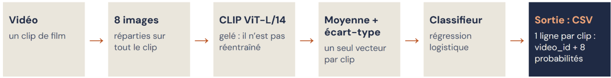

# Reconnaissance des émotions à partir de la vidéo

Cette branche prédit l'émotion d'un extrait à partir de ses images. Elle utilise la [partition commune](../Partition/), sans fournir l'audio ni les descriptions textuelles au modèle.

Le code et les expériences sont disponibles dans [model_video.ipynb](model_video.ipynb).

##  Démarche suivie

Le point de départ est une représentation visuelle préentraînée, suivie d’un classifieur simple. Avec environ 2 200 clips d’apprentissage, cette approche permet de réutiliser des caractéristiques riches sans entraîner un grand réseau visuel sur notre seul corpus.

Nous avons d’abord construit une référence utilisant les métadonnées visuelles, puis étudié **CLIP avec un résumé par moyenne et écart-type**. Des variantes ont ensuite été comparées pour vérifier l’intérêt des métadonnées et d’une prise en compte de l’évolution temporelle : caractéristiques de changement visuel, GRU et combinaison de classifieurs.

Le choix final repose sur la validation croisée sur l’apprentissage. Dans cette branche, les scores de développement et de test sont présentés pour mesurer les performances, sans intervenir dans le choix des réglages ou du modèle final.

## 2. Architecture du modèle retenu

Le modèle combine **CLIP ViT-L/14 gelé**, une agrégation temporelle et une **régression logistique multiclasse**.

### Sélection de huit images

Pour chaque clip, huit images sont sélectionnées uniformément du début à la fin, puis converties en RGB. L’idée est de couvrir plusieurs moments de la scène tout en limitant le coût d’extraction. Si une image ne peut pas être lue, la dernière image disponible est répétée pour conserver huit images.

Ce choix constitue un compromis : il permet de traiter l’ensemble du corpus, mais un événement très bref peut se produire entre deux images sélectionnées.

### Extraction des caractéristiques avec CLIP

Nous utilisons [CLIP ViT-L/14](https://huggingface.co/openai/clip-vit-large-patch14), un modèle préentraîné sur des paires image-texte. Seule sa branche image est utilisée ici : aucune phrase ni liste d’émotions n’est fournie à CLIP lors de l’extraction.

Son encodeur visuel est un Vision Transformer : l’image est représentée par des patches et traitée par des blocs d’attention. La représentation obtenue est projetée dans un vecteur de **768 valeurs**, puis normalisée avec une norme L2 égale à 1. Chaque clip devient ainsi un tableau de **8 × 768 valeurs**.

CLIP reste **gelé** : ses poids ne sont pas modifiés. Cela réduit le coût d’apprentissage et le risque de surapprentissage. Les embeddings sont enregistrés dans un cache pour pouvoir comparer les classifieurs sans répéter l’extraction. Le notebook vérifie que leur ordre correspond à celui des clips dans les annotations.

### Résumé temporel et classification

Pour obtenir un seul vecteur par clip, nous concaténons :

- La **moyenne** des huit embeddings, qui résume leur contenu général.
- Leur **écart-type**, qui décrit la variabilité des caractéristiques entre les images.

Le résultat comporte **1 536 valeurs**. L’écart-type apporte une information sur la diversité des images, mais ne décrit pas leur ordre ni directement le mouvement.

Ces caractéristiques sont centrées et réduites avec un `StandardScaler`, puis transmises à une régression logistique multiclasse. Ce classifieur linéaire apprend à associer la représentation CLIP aux huit émotions. Il produit huit probabilités dont la somme vaut 1 ; la plus élevée détermine la classe prédite.

Ce choix permet de limiter la complexité du classifieur tout en exploitant la richesse des représentations de CLIP.

## Réglages et choix du modèle

### Validation croisée par film

Les réglages sont choisis avec **GroupKFold à cinq plis**, sur l’apprentissage. À chaque itération, le modèle apprend sur quatre plis et est évalué sur le cinquième ; aucun film n’est partagé entre ces deux parties. La standardisation est apprise à l’intérieur de chaque pli, sur sa partie d’entraînement.

Le critère principal est le **F1 macro**, qui donne le même poids à chaque émotion malgré le déséquilibre des classes. L’accuracy et la valence, positive ou négative, complètent l’évaluation.

Deux paramètres de la régression logistique sont comparés :

| Paramètre | Valeurs testées | Valeur retenue |
|---|---|---|
| `C`, inverse de la force de régularisation | De `0,0001` à `1`, sur une grille de neuf valeurs | **0,001** |
| Pondération des classes | Aucune, inverse des fréquences (`balanced`), racine carrée de ces poids (`sqrt`) | **sqrt** |

Un faible `C` impose une régularisation forte. La pondération `sqrt` constitue un compromis entre l’absence de pondération et une compensation complète du déséquilibre.

Pour choisir ces réglages, le notebook conserve les candidats dont le F1 macro moyen se situe à moins d’une erreur-type du meilleur, puis retient celui qui a la meilleure accuracy en validation croisée. Le modèle est ensuite entraîné sur tout l’apprentissage.

### Comparaison des architectures

| Modèle | F1 macro CV, moyenne ± erreur-type | F1 macro dev | F1 macro test |
|---|---:|---:|---:|
| **CLIP moyenne + écart-type, retenu** | **0,3624 ± 0,020** | **0,390** | **0,369** |
| CLIP + métadonnées | 0,3648 ± 0,020 | 0,390 | 0,370 |
| CLIP + changement visuel | 0,3721 ± 0,013 | 0,392 | 0,377 |
| GRU temporel, cinq graines | 0,3509 ± 0,015 | 0,409 | 0,358 |
| Moyenne régression logistique + GRU | 0,3682 ± 0,014 | 0,423 | 0,375 |

Les variantes répondent à différentes questions :

- **Métadonnées** : ajouter la luminosité, la richesse des couleurs, la teinte et la durée complète-t-il CLIP ? La teinte est encodée en sinus et cosinus pour respecter son caractère circulaire. Seules, ces métadonnées obtiennent un F1 macro de **0,0984 sur dev**.
- **Changement visuel** : six caractéristiques calculées à partir des similarités entre embeddings décrivent les différences entre images consécutives et entre le début et la fin du clip. Elles ne correspondent pas à un calcul de flux optique.
- **GRU temporel** : un réseau bidirectionnel lit les huit embeddings dans l’ordre, avec 64 unités cachées par direction et un dropout de 0,5. Les probabilités de cinq réseaux entraînés avec des graines différentes sont moyennées. Le nombre d’époques retenu est de 13, choisi sur les prédictions de validation croisée.
- **Combinaison régression + GRU** : la moyenne de leurs probabilités cherche à associer le résumé global et la représentation temporelle.

Pour choisir l’architecture finale, nous retenons le modèle le plus simple dont le score CV est à moins d’une erreur-type du meilleur. Le meilleur candidat est CLIP + changement visuel, à **0,3721** ; le seuil est **0,3595**. Le modèle CLIP moyenne + écart-type dépasse ce seuil et est donc conservé.

Cette règle privilégie la simplicité lorsque les scores sont proches ; elle ne constitue pas un test de significativité. Le meilleur score de développement de la combinaison régression + GRU ne détermine donc pas le modèle retenu.

## Résultats et limites

| Ensemble | Accuracy | F1 macro | IC 95 % du F1 macro | Accuracy de valence |
|---|---:|---:|---:|---:|
| Développement | 40,5 % | 0,390 | [0,306 ; 0,447] | 72,4 % |
| Test | 41,0 % | 0,369 | [0,305 ; 0,416] | 68,6 % |

Les intervalles sont estimés par **1 000 tirages bootstrap de films**, avec remise. Rééchantillonner les films permet de tenir compte du fait que leurs clips ne sont pas indépendants. Avec seulement 50 films en développement et 50 en test, l’incertitude reste importante : les petits écarts entre modèles doivent être interprétés avec prudence.

Le modèle reconnaît mieux la valence que l’émotion précise. Sur dev, ses **72,4 %** de valence correcte dépassent les **59,3 %** obtenus en prédisant toujours une émotion négative.

La peur est l'émotion la mieux reconnue sur dev ; le dégoût et l'excitation restent plus difficiles. Le résumé par moyenne et écart-type ignore l'ordre des images et peut manquer certains événements brefs. Les résultats montrent donc les limites d'une reconnaissance fondée sur quelques images seulement.

## Autres expériences

Nous avons comparé une référence utilisant les métadonnées, l'ajout de métadonnées ou de caractéristiques de changement visuel à CLIP, un GRU temporel et une combinaison régression logistique + GRU. Les résultats détaillés et la comparaison sont présentés dans le notebook.

## Prédictions pour la fusion

- [probs_video_dev.csv](probs_video_dev.csv)
- [probs_video_test.csv](probs_video_test.csv)

Chaque ligne contient le `video_id` et huit probabilités, une par émotion. Elles permettent de relier les prédictions vidéo à celles des autres branches pour la fusion.

Les chemins vers les vidéos, les listes de films et le cache sont à adapter dans le notebook. Un GPU est recommandé pour la première extraction CLIP.

