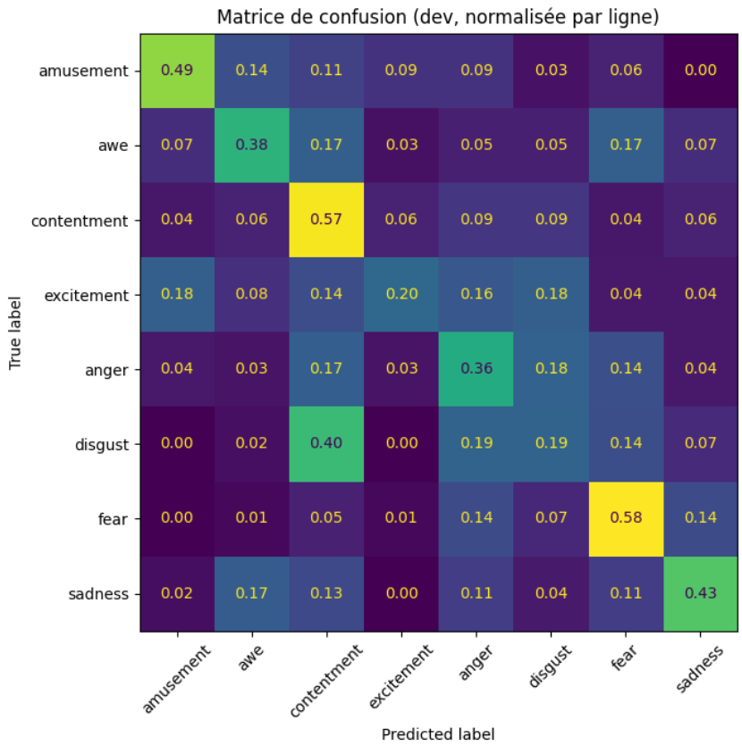

# Reconnaissance des émotions à partir de la vidéo

Cette branche prédit l'émotion d'un extrait à partir de ses images. Elle utilise la [partition commune](../Partition/), sans fournir l'audio ni les descriptions textuelles au modèle.

Le code et les expériences sont disponibles dans [model_video.ipynb](model_video.ipynb).

## Méthode retenue

Nous utilisons [CLIP ViT-L/14](https://huggingface.co/openai/clip-vit-large-patch14) comme extracteur de caractéristiques, suivi d'une régression logistique.

1. **Sélection des images** : nous prenons huit images réparties du début à la fin de chaque clip. Cela permet de couvrir la scène en limitant le nombre d'images à traiter.
2. **Extraction avec CLIP** : chaque image devient un vecteur de 768 valeurs. CLIP reste gelé : nous réutilisons sa représentation visuelle préentraînée sans modifier ses poids.
3. **Résumé du clip** : nous concaténons la moyenne et l'écart-type des huit vecteurs. La moyenne résume le contenu général et l'écart-type sa variabilité entre les images. Chaque clip est ainsi représenté par un vecteur de taille fixe, quelle que soit sa durée.
4. **Classification** : les caractéristiques sont standardisées à partir de l'apprentissage, puis une régression logistique produit huit probabilités d'émotion.

Les embeddings CLIP sont sauvegardés pour éviter de répéter l'extraction lors des expériences suivantes.

## Choix du modèle

Les réglages et le modèle final sont choisis par **validation croisée sur l'apprentissage**, avec cinq plis séparés par film. Dans cette branche, dev et test servent à mesurer les performances.

Le critère principal est le F1 macro, qui donne le même poids à chaque émotion. Parmi les modèles dont le score est proche du meilleur selon une marge d'une erreur-type, nous retenons le plus simple. Cette règle conduit à conserver CLIP avec moyenne et écart-type, suivi de la régression logistique.

## Résultats et limites

| Ensemble | Accuracy | F1 macro |
|---|---:|---:|
| Développement | 40,5 % | 0,390 |
| Test | 41,0 % | 0,369 |

La peur est l'émotion la mieux reconnue sur dev ; le dégoût et l'excitation restent plus difficiles. Le résumé par moyenne et écart-type ignore l'ordre des images et peut manquer certains événements brefs. Les résultats montrent donc les limites d'une reconnaissance fondée sur quelques images seulement.

## Autres expériences

Nous avons comparé une référence utilisant les métadonnées, l'ajout de métadonnées ou de caractéristiques de changement visuel à CLIP, un GRU temporel et une combinaison régression logistique + GRU. Les résultats détaillés et la comparaison sont présentés dans le notebook.

## Prédictions pour la fusion

- [probs_video_dev.csv](probs_video_dev.csv)
- [probs_video_test.csv](probs_video_test.csv)

Chaque ligne contient le `video_id` et huit probabilités, une par émotion. Elles permettent de relier les prédictions vidéo à celles des autres branches pour la fusion.

Les chemins vers les vidéos, les listes de films et le cache sont à adapter dans le notebook. Un GPU est recommandé pour la première extraction CLIP.

